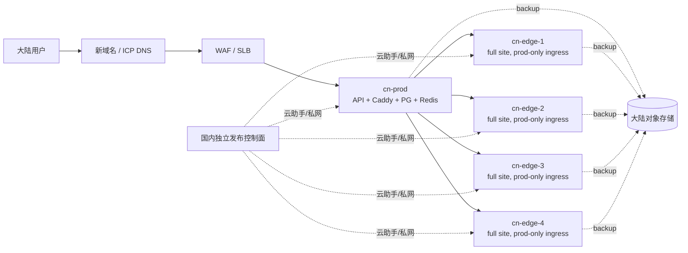

# 目标与边界

在中国大陆新建一个独立域名和独立部署，服务大陆用户，同时保持现有 Hetzner 五节点
站点稳定运行。这是新部署，不是迁移现网主机或复制现网生产库。

国内站点固定为 `1 prod + N edge`，一期 `N=4`。只接入 Agent Plan 和 Token Plan
账号，提供后端 API、API key 和基础用量统计。用户、余额、兑换码、管理员、上游账号池、
JWT/TOTP 密钥和数据库均不与现网共享。两个站点不做跨地域双写，也不把一套 PostgreSQL
做成跨境主从。

本方案是部署设计，不包含云资源创建、域名注册、ICP备案、数据导入或流量切换。
域名、云厂商、合规主体和是否需要境外上游出口仍需业务决策。

# 推荐基线

采用 UCloud 的 VPC、负载均衡/WAF、云主机、对象存储、密钥管理和云助手/远程执行能力。
每个 prod/edge 节点运行一套与现网 Stage0 兼容的 Docker Compose：Caddy、
TokenKey、PostgreSQL、Redis 和持久化数据卷。prod 是唯一的公共 API 入口；edge 只接受
prod relay 和运维通道，承担对应平台账号池。

一期不引入 Kubernetes，不把五个节点改造成共享数据库集群。这样能直接复用现有
`1 prod + N edge` 的路由、账号、drain、回滚和数据边界。数据库高可用通过备份、恢复
演练和节点重建保证；业务增长后再单独评估托管 PostgreSQL/Redis 或 HA 集群。

## 节点与网络

生产基线保留五台计算节点：

| 节点 | 数量 | 作用 | 暴露面 |
|---|---:|---|---|
| `cn-prod` | 1 | 公共 API、完整前端/管理面、prod relay、Agent/Token 计划映射、本地 PostgreSQL/Redis | 仅经 WAF/SLB 接收公网 80/443 |
| `cn-edge-1..4` | 4 | 完整前端/管理面、对应平台账号池、edge relay、本地 PostgreSQL/Redis | 只允许 `cn-prod` 固定源地址、私网域名和运维通道 |

每个节点都使用独立数据卷和独立 secrets。PostgreSQL 是该节点业务事实源，Redis 可丢失
并重建；节点之间不共享数据库。云助手/SSM、镜像仓库和对象存储属于控制面，不新增一台
必需的运维业务节点。

VPC 至少划分 WAF/SLB、业务节点、运维/数据三个安全域。数据库和 Redis 不分配公网
地址，安全组只允许本节点 TokenKey、prod→edge relay 和备份任务访问。Edge 入站同时受
两层限制：UCloud 安全组只放行 `cn-prod` 的固定私网源地址（必要时再加固定公网出口），
应用层 Caddy 只接受约定的 edge 管理域名/SNI 和来自 prod 的 Host/来源标识；域名只负责
路由，真正的访问边界由源地址、TLS 和安全组保证。应用出站按平台域名/IP allowlist
限制，禁止把国内节点当作任意互联网代理。

# 域名与合规

1. 选择新的正式域名（例如 `api.example.cn`，实际名称待定），在大陆 DNS 服务商托管，
   完成 ICP 备案；上线后按主体要求完成公安联网备案和云厂商备案接入。
2. WAF/CDN 终止公网 TLS，证书由云证书服务托管并自动续期。网关到应用使用内网
   TLS/mTLS；应用不依赖 Caddy 自动申请公网证书。
3. 新域名只指向国内 WAF/SLB。现有 `api.tokenkey.dev`、四个 Hetzner edge 域名和
   现网 DNS TTL 不改；一期不做 GeoDNS 或同域名权重分流。
4. 访问日志、审计日志和备份落在大陆地域，设置保留期限、脱敏规则和访问审计。跨站
   排障只传 request id、时间窗、状态码和聚合指标，不传用户凭据、OAuth token 或原始
   请求内容。

# 密钥、账号与数据边界

- 国内站生成全新的 `JWT_SECRET`、`TOTP_ENCRYPTION_KEY`、数据库密码、Redis 密码、
  管理员初始凭据和 webhook secret，并放入国内 KMS/Secrets Manager；GitHub secrets
  只保存云端短期身份和镜像发布所需的最小权限。
- 国内上游账号池单独创建、单独分组和单独限额。现网账号不可通过复制数据库或导入
  `.env` 的方式复用。
- PostgreSQL 是业务事实源；Redis 可丢失并重建。用户、余额、兑换码、API key 和
  计费流水不做跨站同步。若未来需要迁移，使用一次性脱敏导出、字段映射、校验和及
  人工确认，不执行旧库覆盖新库。
- 国内站和现网站点可以共享公开镜像源码和发布版本号，但每个站点记录自己的镜像
  digest、配置快照、数据库迁移版本和恢复点。

# 云厂商评估

本轮不把阿里云、百度智能云、腾讯云列入候选；选型看网络、主机、数据库、对象存储、
安全和自动化能力，不看大模型供应能力。

| 优先级 | 厂商 | 适合点 | 主要取舍 |
|---|---|---|---|
| 1（已选） | **UCloud** | 独立云厂商，云主机、私网、负载均衡、托管 PostgreSQL/Redis、对象存储和 API 较直接，适合复刻现有 Compose/Stage0 | 地域、生态和可观测性深度小于头部厂商；跨地域灾备选择较少，需先做 PoC |
| 2 | **华为云** | 大陆地域和网络覆盖完整；VPC、ECS、ELB/WAF、云数据库 PostgreSQL、Redis、对象存储、KMS、云助手和监控产品齐全；安全与合规材料成熟 | 产品面较大，IAM 和网络配置需要专人维护；费用需按实际地域和出站量核算 |
| 3 | **青云 QingCloud** | 私有网络、主机、负载均衡、托管数据库和对象存储组合清晰，适合成本敏感的五节点独立站 | 地域覆盖和运维生态较小；高峰出站、云助手和支持 SLA 要实测确认 |
| 备选 | **中国电信云 / 中国移动云 / 中国联通云** | 国内网络和政企合规、专线、工单支持强，适合已有运营商采购或行业合规要求 | 开发者 API、镜像同步和 CI/CD 体验通常弱于公有云，需要把发布控制面 PoC 做深 |
| 备选 | **京东云** | 企业级主机、网络、数据库和安全产品完整，适合已有京东云账户或采购关系 | 生态和跨地域运维工具仍需按目标地域核实；不因其模型能力选型 |

已选择 **UCloud**。华为云、青云、运营商云和京东云保留为故障替代或后续灾备候选，
不进入一期资源创建。AWS China、Azure China 不作为一期替代，因为账号和运营主体独立，
镜像、控制面和支持路径会再增加一套边界。

最终签约前做七天 PoC：五节点跨可用区网络、云助手无 SSH 执行、国内镜像拉取、Agent/Token
上游成功率、对象存储备份/恢复、节点重建、WAF/SLB 观测和费用/出站账单。PoC 结果写入
站点 target matrix 的 `provider`、`region` 和 `approved_anchor`，不得凭产品目录直接上线。

# 镜像与发布控制面

现网发布继续使用 GitHub Actions、GHCR 和既有 Hetzner/SSM 路径。国内站建立独立的
发布环境、并发锁、镜像仓库和云助手通道，不复用现网的 `prod` environment、SSM 参数
前缀或回滚凭据。国内目标矩阵固定为 `prod`、`edge-1`、`edge-2`、`edge-3`、`edge-4`。

镜像构建不重复实现：继续复用现有 `release.yml` 完成版本、前端构建、后端构建、多架构
镜像、SBOM 和 GHCR digest。`domestic-release.yml` 接收一个已经发布的 tag/digest，先
校验 digest，再把同一镜像同步到 UCloud 镜像仓库并部署国内目标。这样只有发布目标和
控制通道分开，构建事实仍只有一个来源。

推荐发布链路：

1. GitHub Actions 构建一次多架构镜像，生成 SBOM、签名和不可变 digest。
2. 通过受控镜像同步作业把同一 digest 推送到国内仓库。同步失败不得产生“国内已发布”
   状态；必要时由合规 relay 执行 `skopeo copy`，国内节点不访问 GHCR。
3. 使用国内云助手/SSM 通过私网下发升级，不开放 SSH 入站。云 API 身份、命令通道、
   secrets 前缀和审计日志全部属于 `domestic` 发布环境。
4. **公共代码/运行时发布**：edge canary → prod → 其余 edge，沿用 Stage0 的 drain、
   in-flight 归零、digest 切换、`/health/live`/`/health/ready` 检查和 fail-stop。
5. **平台/账号/模型映射变更**：由人类先判断影响矩阵，只 dispatch 受影响的 edge；若
   只影响 prod relay 或站点配置，则只部署 prod。无需同时发布的目标保持原 digest。
6. 回滚只引用上一个已验收 digest 和配置快照，不重新构建镜像。数据库迁移保持向前兼容；
   破坏性迁移先拆成 expand/migrate/contract，未具备回滚路径不得进入生产。

建议后续新增 `deploy/domestic/` 目标矩阵和 dispatcher，字段至少包括 `site_id`、
`role`、`edge_id`、`platform`、`region`、`domain`、`registry`、`cloud_assistant_target`、
`secret_prefix`、`backup_prefix`、`deployable` 和 `approved_anchor`。现有
`deploy/hetzner/` 矩阵不应混入国内目标。

发布工作流至少拆成两条：

- `domestic-release.yml`：校验并同步既有镜像 digest，执行 edge canary、prod、剩余 edge、
  回滚和运行时 smoke。
- `domestic-platform-ops.yml`：账号导入/刷新、Agent/Token 计划账号变更、平台模型映射和
  单 edge 配置；每次必须有显式 target，禁止默认 all。

影响矩阵：公共 backend/Compose/安全补丁才走全站 release；某平台账号或 fingerprint
只走该平台 edge；edge 账号池只走该 edge；prod relay/model mapping 只走 prod；文档和
不影响运行时的配置不部署。人类可以把目标扩展到全站，但 dispatcher 必须记录理由和
审批 receipt。

## 与现网发布的区别

| 项目 | 现网发布 | 国内发布 | 实际影响 |
|---|---|---|---|
| 目标 | Hetzner 的现网 prod/edge 矩阵 | UCloud 的 `domestic/prod`、`domestic/edge-1..4` 矩阵 | 两边不会因为同一个 tag 自动互相部署 |
| 控制通道 | 既有 GitHub Actions + AWS/SSM Hybrid + Hetzner resolver | 独立 GitHub Environment + UCloud 云助手/远程执行 | 凭据、权限、审计和回滚入口完全分开 |
| 镜像 | 现网从 GHCR 拉取 | UCloud 镜像仓库中的同 digest | `release.yml` 统一构建，国内只做同步和部署 |
| 发布范围 | 现有 Stage0 支持 prod、edge canary、全 edge rollout，以及较完整的平台 smoke | `domestic-release.yml` 只管国内公共运行时；按 `prod + 4 edge` 顺序发布 | 国内发布失败只停在国内，不会回滚 Hetzner |
| 平台/账号变更 | 现有账号运维脚本按现网目标执行，部分操作可选 prod/edge/all | `domestic-platform-ops.yml` 强制要求一个明确国内 target | 只改某个平台或某个 edge 时，其余节点不重启、不换镜像 |
| 验证 | 现网保留既有完整 smoke、模型映射和平台相关检查 | 只做 health、API key、Agent/Token 请求和用量递增 | 国内没有 QA 账号、QA worker、raw archive 或完整 QA 流程 |
| 数据 | 现网各自的 Hetzner 数据卷和备份前缀 | UCloud 节点独立数据卷和 `site_id=domestic` 备份前缀 | 不复制现网库，不会把国内用户写入现网 |

白话解释：`domestic-release.yml` 相当于“国内版总发布按钮”，只负责国内这五个节点的
公共代码、Compose、主机安全补丁和回滚；它不是现有 `release.yml` 或
`deploy-stage0.yml` 的开关，也不会顺手更新现网。`domestic-platform-ops.yml` 相当于
“国内版定点维修按钮”，例如只给 Agent Plan 的 `edge-2` 换账号，只执行 `edge-2` 的
账号导入和验证，不构建新镜像，也不触碰其他 edge。

唯一需要人判断的是“影响范围”：公共 backend 变更才扩大到全站；账号、平台映射或
fingerprint 变更只选受影响的 target。两套站点可以暂时运行不同版本，但数据库迁移必须
保持向前兼容，并在发布 receipt 中记录每个站点的 digest 和 schema 版本。

# 备份、恢复与灾难演练

- 每个节点的 PostgreSQL 每日生成加密逻辑备份到大陆对象存储，并保留至少一个不同可用区
  的副本。Redis 仅保存 AOF/RDB 作为加速恢复材料，不作为计费或用户数据事实源。
- 备份对象使用 KMS 独立密钥，生产运行密钥与备份解密权限分离。备份命名必须含
  `site_id=domestic` 和 `target=prod|edge-<id>`，恢复工具拒绝读取现网前缀。
- 每周在隔离的临时 PostgreSQL 中做 restore canary，验证压缩包大小、SHA-256、关键表
  可查询性和清理结果；这是运维恢复验证，不建立 QA 环境、不产生 QA 账号或 QA raw archive。
  沿用现有 `pgdump_restore_canary` 的 fail-stop 和 cleanup 约束。
- 目标值建议为 RPO 15 分钟、RTO 60 分钟，需在审批时确认。恢复顺序：数据库 → Redis
  重建 → 应用节点 → 网关/WAF → smoke；恢复期间 DNS 不切回现网，先用临时管理域名验收。
- 灾难演练至少覆盖：单应用节点丢失、网关节点丢失、数据库主库故障、整套地域恢复、
  镜像仓库不可用和密钥轮换。每次演练保留时间线、恢复点和未解决项。

# 服务范围

国内五个节点都部署完整的运营站点：后端 API、API key 鉴权、Agent Plan/Token Plan 账号
选择、用户/账号管理、用量记录与基础统计、管理员审计、健康检查，以及内置的前端和管理面。
只有 `cn-prod` 对公网提供用户入口；`cn-edge-1..4` 的 frontend/admin 也存在，但只接受
来自 `cn-prod` 的固定源地址、约定域名和运维通道。

完整站点不需要额外的前端服务器：当前镜像会在构建时把 frontend embed 到 TokenKey 二进制，
prod 的 Caddy 开放站点和 `/admin`，edge 的 Caddy 只对 prod/运维来源开放同一套站点和
`/admin`。运营入口建议使用独立管理域名或管理路径，并加办公网/VPN allowlist、强管理员
认证和审计。

“完整”只代表运营所需的前后端和管理面，不代表打开所有产品模块。QA、Gemini worker、媒体
和其他未部署依赖的菜单/路由必须由能力开关或权限隐藏，并在 backend 侧拒绝实际调用。

与 API-only 的差异：

| 项目 | API-only | prod 完整运营站点 |
|---|---|---|
| 进程/节点 | Caddy + TokenKey + PostgreSQL + Redis | 相同，不新增前端进程或节点 |
| 镜像 | 当前默认镜像仍包含 embed frontend | 同一镜像直接开放 frontend/admin 路由 |
| CPU/内存 | 主要消耗来自 API、上游请求、PostgreSQL/Redis | 基线基本相同；增加页面请求、静态资源、用户/账号列表和统计查询负载 |
| 带宽/日志 | 低，主要是 API 流量 | 高一些，增加静态资源、管理操作和浏览器日志；可由 CDN/WAF 缓存静态资源 |
| 安全面 | 公开路由少 | 多出登录、管理、静态资源和管理员攻击面，需要 allowlist、审计和更严格告警 |
| 运营能力 | 主要靠脚本/API | 五个节点都可运营；公网用户只进入 prod，edge 由 prod 或运维入口访问 |

因此五个节点统一部署完整运营站点，减少两套运行形态带来的心智负担。额外资源主要是
管理请求、统计查询和静态资源带宽，通常远小于新增一台业务节点；真正的容量瓶颈仍是
上游请求、数据库连接、Redis 和账号池。上线前用运营并发和统计查询做一次压测，以实际
数据决定 UCloud 机型，不为了前端单独扩容。

明确不部署、不接入：QA prod/edge、QA capture/raw archive/worker/queue、媒体或其他功能
工具、非 Agent/Token 账号池、跨站用户/余额同步，以及与这些功能绑定的 workflow、bucket、
secret 和告警。任何后来新增功能先更新本节和 target matrix，再单独评审。

# 监控与日常运维

最低监控集合：WAF 命中/拦截、prod/edge 5xx 和延迟、每个节点健康与 in-flight、数据库
连接/磁盘、Redis 内存/命中率、备份 receipt 新鲜度、镜像 digest 漂移、证书有效期、云
账单和出站流量。告警按“用户请求失败、数据恢复风险、供应能力下降、容量不足、合规/
安全事件”分组，并带 `site_id=domestic` 与 `target` 标签。

日常变更使用小批量和可观测窗口：先执行只读 preflight，再发布 canary；发布后立即和
延迟观察窗口分别做 smoke。账号池调整、模型映射、限流和计费配置必须通过国内站点的
管理员审计记录，禁止直接改生产数据库。供应商凭据故障与应用发布分开排查，避免用镜像
回滚掩盖上游故障。

# 上线分阶段与验收门槛

## 阶段 0：准备（不接用户流量）

- 完成主体、域名、ICP/公安备案、云账号、VPC、安全组、KMS、镜像仓库和五个 target。
- 生成并核对国内独立 secrets；验证节点不能从公网访问 PostgreSQL/Redis。
- 先点火四个 edge，再点火 prod relay；用受限合成 key 做 API/用量 smoke，不建立 QA 资源。

## 阶段 1：内部 canary

- 新域名启用 WAF，限制为办公出口或临时 allowlist；不建立现网用户的 DNS 跳转。
- 验证 API key、Agent/Token 请求、用量统计、上游失败、管理员审计和 drain 发布；至少
  完成一次 restore canary。

## 阶段 2：小规模开放

- 仅邀请新站点用户，独立发放 API key；观测 24 小时的 2xx/4xx/5xx、P95、用量计数和
  上游成功率。异常时撤销 WAF allowlist 或停用国内域名即可回退，不修改现网 DNS。

## 阶段 3：正式运营

- 通过发布、备份恢复、密钥轮换和节点替换演练；确认告警有人接收，runbook 能在无 SSH
  情况下执行。达到连续观察窗口后才扩大配额和账号池。

# 需要审批的决策

1. UCloud 主地域/灾备地域和最终产品组合；先做七天 PoC，再创建正式资源。
2. 新正式域名、备案主体和数据保留期限。
3. 国内站是否只使用境内供应商；若需境外供应，relay 所在地、合规评估和允许传输的
   最小数据集合。
4. 是否接受五个独立 Compose target（1 prod + 4 edge）及 RPO 15 分钟、RTO 60 分钟目标。
5. 是否确认仅 Agent Plan/Token Plan、API key、基础用量统计和 prod 运营管理面；QA 和
   其他工具永久不进入一期发布基线。

审批通过后再拆分实现任务：`deploy/domestic` 目标矩阵、国内云助手、镜像同步、站点级
secrets/备份前缀、目标选择 dispatcher、生产合成 key smoke 套件和恢复演练脚本；在此
之前不创建云资源、不改现网 workflow、不切换 DNS。
