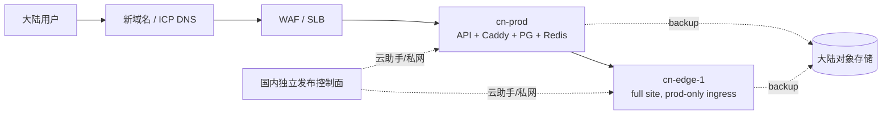

# 目标与边界

在中国大陆新建一个独立域名和独立部署，服务大陆用户，同时保持现有 Hetzner 五节点
站点稳定运行。这是新部署，不是迁移现网主机或复制现网生产库。

国内站点采用 `1 prod + N edge`，一期精简为 `1 prod + 1 edge`（`N=1`），后续按容量扩容。
只接入 Agent Plan 和 Token Plan 账号，提供后端 API、API key 和基础用量统计。用户、余额、兑换码、管理员、上游账号池、
JWT/TOTP 密钥和数据库均不与现网共享。两个站点不做跨地域双写，也不把一套 PostgreSQL
做成跨境主从。

本方案是部署设计，不包含云资源创建、域名注册、ICP备案、数据导入或流量切换。
UCloud 已确定，使用正式生产资源，目标为方案确认后的次日向新客户提供服务；不设置七天 PoC
等待期。仅接入境内供应商，不建设境外 relay 或上游出口。具体地域、机型/费用、数据保留
期限及恢复目标仍须落实，次日交付不能替代上线验证。

# 推荐基线

采用 UCloud 的 VPC、负载均衡/WAF、云主机、对象存储、密钥管理和远程执行通道；具体
UCloud 产品组合由正式资源清单、API 可用性、费用和上线验收确定。
每个 prod/edge 节点运行一套与现网 Stage0 兼容的 Docker Compose：Caddy、
TokenKey、PostgreSQL、Redis 和持久化数据卷。prod 是唯一的公共 API 入口；edge 只接受
prod relay 和运维通道，承担对应平台账号池。

一期不引入 Kubernetes，不把两个节点改造成共享数据库集群。这样能直接复用现有
`1 prod + N edge` 的路由、账号、drain、回滚和数据边界。每个节点的 PostgreSQL 仍是单点，
备份、恢复演练和节点重建提供灾难恢复能力，不承诺自动故障切换；数据库 HA 另行评估。

## 节点与网络

一期生产基线仅部署两台计算节点：

| 节点 | 数量 | 作用 | 暴露面 |
|---|---:|---|---|
| `cn-prod` | 1 | 公共 API、完整前端/管理面、prod relay、Agent/Token 计划映射、本地 PostgreSQL/Redis | 仅经 WAF/SLB 接收公网 80/443 |
| `cn-edge-1` | 1 | 完整前端/管理面、全部一期 Agent/Token 平台账号池、edge relay、本地 PostgreSQL/Redis | 只允许 `cn-prod` 固定源地址、私网域名和运维通道 |

每个节点都使用独立数据卷和独立 secrets。PostgreSQL 是该节点业务事实源，Redis 可丢失
并重建；节点之间不共享数据库。prod 负责国内用户、余额、API key、兑换码和计费事实；
edge 只负责本 edge 的 Agent/Token 账号、平台映射和运行状态。云助手/SSM、镜像仓库和
对象存储属于控制面，不新增一台必需的运维业务节点。

一期的 Agent Plan 和 Token Plan 账号池共用 `cn-edge-1`，按平台分组和限额。唯一 edge
故障会中断该站全部上游供应，prod 本身也没有热备；备份恢复不能替代计算节点冗余。
后续新增 edge 时再创建资源、更新目标矩阵并迁移对应账号池，不提前保留空节点。

VPC 至少划分 WAF/SLB、业务节点、运维/数据三个安全域。数据库和 Redis 不分配公网
地址，仅允许本节点应用和必要的本地备份任务访问；prod→edge relay 只访问 edge 的
HTTPS 网关，不开放 edge 数据库或 Redis 端口。Edge 入站同时受
两层限制：UCloud 安全组只放行 `cn-prod` 的固定私网源地址（必要时再加固定公网出口），
应用层 Caddy 只接受约定的 edge 管理域名/SNI 和来自 prod 的 Host/来源标识；域名只负责
路由，真正的访问边界由源地址、TLS 和安全组保证。应用出站按平台域名/IP allowlist
限制，禁止把国内节点当作任意互联网代理。

# 域名与合规

1. 候选公共入口为 `api-cn.tokenkey.dev`，与现网 `api.tokenkey.dev` 使用不同主机名，
   不要求另外注册一个主域名。DNS/TLS 技术上可使用该子域名；大陆上线前必须核实
   `tokenkey.dev` 的后缀、注册商、实名主体是否满足工信部备案和 UCloud 接入要求，
   已有备案是否需要新增网站或接入。当前未取得该核验结果，不能视为可上线域名；若
   不满足条件，再选择可备案的新主域名。用户决定备案事项后续处理；这不代表 UCloud
   已允许未备案域名公网接入。公网客户交付前须核实云厂商接入要求并实测域名可达性，
   若被限制则明确阻塞，不能把创建 DNS 记录当作上线成功。DNS 托管位置本身不能替代备案。
2. WAF/CDN 终止公网 TLS，证书由云证书服务托管并自动续期。网关到应用使用内网
   TLS/mTLS；应用不依赖 Caddy 自动申请公网证书。
3. 新域名只指向国内 WAF/SLB。现有 `api.tokenkey.dev`、四个 Hetzner edge 域名和
   现网 DNS TTL 不改；一期不做 GeoDNS 或同域名权重分流。
4. 访问日志、审计日志和备份落在大陆地域，设置保留期限、脱敏规则和访问审计。跨站
   排障只传 request id、时间窗、状态码和聚合指标，不传用户凭据、OAuth token 或原始
   请求内容。

# 密钥、账号与数据边界

- 国内站生成全新的 `JWT_SECRET`、`TOTP_ENCRYPTION_KEY`、数据库密码、Redis 密码、
  管理员初始凭据和 webhook secret，并放入国内 KMS/Secrets Manager；GitHub secrets
  只保存云端短期身份和镜像发布所需的最小权限。
- 国内上游账号池单独创建、单独分组和单独限额，仅启用境内供应商的境内服务端点；
  不配置境外 relay、境外供应或境外故障回退。现网账号不可通过复制数据库或导入 `.env`
  的方式复用。
- PostgreSQL 是业务事实源；Redis 可丢失并重建。用户、余额、兑换码、API key 和
  计费流水不做跨站同步。若未来需要迁移，使用一次性脱敏导出、字段映射、校验和及
  人工确认，不执行旧库覆盖新库。
- 国内站和现网站点可以共享公开镜像源码和发布版本号，但每个站点记录自己的镜像
  digest、配置快照、数据库迁移版本和恢复点。

# 正式资源与交付

一期直接使用 UCloud 正式生产资源，不另建七天 PoC 环境，不创建其他云厂商或境外灾备
节点。仅创建 `cn-prod` 与 `cn-edge-1` 两台计算节点；备份存放于大陆对象存储，灾备恢复
按已验证的备份和节点重建执行，不预建第三台热备计算节点。

资源创建前形成可执行清单：项目、主地域/可用区、机型、磁盘、网络出口、镜像仓库、对象
存储、远程执行及凭据方案、预计费用。地域与预算未确定的项目保留待定，不把本机只读查询
过的地域当作已获批准的生产地域。正式节点先在受限网络下部署和验证，再接入客户流量。

上线前实测 prod→edge 网络、国内镜像拉取、Agent/Token 上游成功率、请求计费/用量、
管理员入口、备份恢复、发布回滚和告警。验证结果与实际资源身份写入目标矩阵及发布回执；
不等待固定七天，但任何关键验收失败仍须修复后才能交付。

# 镜像与发布控制面

现网发布继续使用 GitHub Actions、GHCR 和既有 Hetzner/SSM 路径。国内站建立独立的
发布环境、并发锁、镜像仓库和云助手通道，不复用现网的 `prod` environment、SSM 参数
前缀或回滚凭据。国内一期目标矩阵只包含 `prod`、`edge-1`；不预建其他 edge 资源。

镜像构建不重复实现：继续复用现有 `release.yml` 完成版本、前端构建、后端构建、多架构
镜像和 GHCR digest。当前 GoReleaser 配置关闭 SBOM/provenance，发布链也未生成镜像签名，
不能把这些能力当成已有验收证据。`domestic-release.yml` 接收一个已经发布的 tag/digest，先
校验 digest，再把同一镜像同步到 UCloud 镜像仓库并部署国内目标。这样只有发布目标和
控制通道分开，构建事实仍只有一个来源。

推荐发布链路：

1. GitHub Actions 构建一次多架构镜像，记录不可变 digest；若国内上线要求 SBOM、签名，
   在共享构建链补齐生成及验证后再验收，不另建国内构建链。
2. 通过受控镜像同步作业把同一 digest 推送到国内仓库。同步失败不得产生“国内已发布”
   状态；必要时由合规 relay 执行 `skopeo copy`，国内节点不访问 GHCR。
3. 使用国内云助手/SSM 通过私网下发升级，不开放 SSH 入站。云 API 身份、命令通道、
   secrets 前缀和审计日志全部属于 `domestic` 发布环境。
4. **公共代码/运行时发布**：edge-1 验证通过 → prod，沿用 Stage0 的 drain、
   in-flight 归零、digest 切换、`/health/live`（存活）与 `/health`（就绪）检查和 fail-stop；prod 还要
   检查公网 frontend/admin，edge 只从 prod 固定来源检查受限 frontend/admin。
   一期没有其他 edge 承接流量；edge 升级须验证 drain、恢复和回滚，不能将先发唯一 edge
   等同于有冗余的 canary，也不承诺跨节点零中断。
5. **平台/账号/模型映射变更**：dispatcher 按下文影响矩阵推导并校验 target，无法确定
   范围时停止并交人判断；只 dispatch 受影响的目标。账号或配置变更不换镜像；代码中
   的平台 fingerprint 变更仍须同步新 digest，并对受影响节点执行 drain、升级和 smoke。
6. 回滚只引用上一个已验收 digest 和配置快照，不重新构建镜像。数据库迁移保持向前兼容；
   破坏性迁移先拆成 expand/migrate/contract，未具备回滚路径不得进入生产。

建议后续新增 `deploy/domestic/` 目标矩阵和 dispatcher，字段至少包括 `site_id`、
`role`、`edge_id`、`platform`、`region`、`domain`、`registry`、`cloud_assistant_target`、
`secret_prefix`、`backup_prefix`、`deployable` 和 `approved_anchor`。现有
`deploy/hetzner/` 矩阵不应混入国内目标。

发布工作流至少拆成两条：

- `domestic-release.yml`：校验并同步既有镜像 digest，按影响矩阵执行全站或指定目标升级、
  回滚和运行时 smoke；全站顺序为 edge-1 验证通过 → prod。
- `domestic-platform-ops.yml`：账号导入/刷新、Agent/Token 计划账号变更、平台模型映射和
  单 edge 配置；每次必须有显式 target，禁止默认 all。

影响矩阵：公共 backend/Compose/安全补丁走全站 release；某平台账号或 fingerprint
只走实际承载该平台的目标；edge 账号池只走该 edge；prod relay/model mapping 只走 prod；
文档和不影响运行时的配置不部署。镜像或主机运行时变更走 release，账号/配置操作走
platform-ops，不能把编译进镜像的 fingerprint 修复当成账号操作。release 必须支持按
矩阵限定目标并拒绝遗漏依赖；人类可以扩展到全站，但 dispatcher 必须记录理由和审批 receipt。

## 与现网发布的区别

| 项目 | 现网发布 | 国内发布 | 实际影响 |
|---|---|---|---|
| 目标 | Hetzner 的现网 prod/edge 矩阵 | UCloud 的 `domestic/prod`、`domestic/edge-1` 矩阵 | 两边不会因为同一个 tag 自动互相部署 |
| 控制通道 | 既有 GitHub Actions + AWS/SSM Hybrid + Hetzner resolver | 独立 GitHub Environment + UCloud 云助手/远程执行 | 凭据、权限、审计和回滚入口完全分开 |
| 镜像 | 现网从 GHCR 拉取 | UCloud 镜像仓库中的同 digest | `release.yml` 统一构建，国内只做同步和部署 |
| 发布范围 | 现有 Stage0 支持 prod、edge canary、全 edge rollout，以及较完整的平台 smoke | `domestic-release.yml` 管国内运行时；全站按 edge-1 验证通过 → prod，平台代码按影响矩阵限定目标 | 国内发布失败只停在国内，不会回滚 Hetzner |
| 平台/账号变更 | 现有账号运维脚本按现网目标执行，部分操作可选 prod/edge/all | `domestic-platform-ops.yml` 强制要求一个明确国内 target | 只改某个平台或某个 edge 时，其余节点不重启、不换镜像 |
| 验证 | 现网保留既有完整 smoke、模型映射和平台相关检查 | health、API key、Agent/Token 请求、用量递增及本文 UI/权限和恢复验收 | 国内没有 QA 账号、QA worker、raw archive 或完整 QA 流程 |
| 数据 | 现网各自的 Hetzner 数据卷和备份前缀 | UCloud 节点独立数据卷和 `site_id=domestic` 备份前缀 | 不复制现网库，不会把国内用户写入现网 |

白话解释：`domestic-release.yml` 相当于“国内版总发布按钮”，只负责国内这两个节点的
运行时升级、Compose、主机安全补丁和回滚；它不是现有 `release.yml` 或
`deploy-stage0.yml` 的开关，也不会顺手更新现网。`domestic-platform-ops.yml` 相当于
“国内版定点维修按钮”，例如只给 Agent Plan 的 `edge-1` 换账号，只执行 `edge-1` 的
账号导入和验证，不构建新镜像，也不重启 prod。

影响范围由 dispatcher 根据变更类型和目标矩阵计算，无法识别的依赖及范围扩展才交人判断。
两套站点可以暂时运行不同版本，但数据库迁移必须
保持向前兼容，并在发布 receipt 中记录每个站点的 digest 和 schema 版本。

# 备份、恢复与灾难演练

- 每个节点的 PostgreSQL 每日生成加密逻辑备份到大陆对象存储，并保留至少一个不同可用区
  的副本。Redis 仅保存 AOF/RDB 作为加速恢复材料，不作为计费或用户数据事实源。
- 备份对象使用 KMS 独立密钥，生产运行密钥与备份解密权限分离。备份命名必须含
  `site_id=domestic` 和 `target=prod|edge-<id>`，恢复工具拒绝读取现网前缀。
- 每周在隔离的临时 PostgreSQL 中做 restore canary，验证压缩包大小、SHA-256、关键表
  可查询性和清理结果；这是运维恢复验证，不建立 QA 环境、不产生 QA 账号或 QA raw archive。
  沿用现有 `pgdump_restore_canary` 的 fail-stop 和 cleanup 约束。
- 目标值建议为 RPO 15 分钟、RTO 60 分钟，需在审批时确认。恢复顺序：数据库 → Redis
  重建 → 应用节点 → 网关/WAF → smoke；恢复期间 DNS 不切回现网，先用临时管理域名验收。
  每日逻辑备份本身不能兑现该 RPO；若批准 15 分钟目标，须增加基础备份与连续 WAL
  归档/PITR，将归档延迟纳入告警，并实测最近可恢复事务距故障点不超过 15 分钟。
  这套恢复链尚未实现；若一期只做逻辑备份，须重新审批其实际可恢复窗口，不能沿用该目标。
- 灾难演练至少覆盖：单应用节点丢失、网关节点丢失、数据库主库故障、整套地域恢复、
  镜像仓库不可用和密钥轮换。每次演练保留时间线、恢复点和未解决项。

# 服务范围

国内两个节点都部署同一套完整的运营站点镜像：后端 API、API key 鉴权、Agent Plan/Token
Plan 账号选择、用户/账号管理、用量记录与基础统计、管理员审计、健康检查，以及内置的
前端和管理面。只有 `cn-prod` 对公网提供用户入口；`cn-edge-1` 的 frontend/admin 也
存在，但只接受来自 `cn-prod` 的固定源地址、约定域名和运维通道。

管理职责按数据归属限制：prod 管国内用户、余额、API key、兑换码、计费和全站统计；edge
只管本 edge 的 Agent/Token 账号、平台映射、容量和健康状态。edge 不提供用户和余额管理，
这些页面应隐藏或跳转到 prod；backend 同时拒绝 edge 上面向终端用户的注册、用户/余额、
兑换码和业务 API key 管理调用，不能仅靠隐藏菜单隔离。edge 管理员认证和 prod relay 所需
的内部身份仍须保留，权限与终端用户运营功能分开。节点角色与能力由一个共享策略 owner
裁决，前端据此展示、后端强制执行；该能力是后续实现项，当前完整镜像不自动满足此边界。

完整站点不需要额外的前端服务器：当前镜像会在构建时把 frontend embed 到 TokenKey 二进制，
prod 的 Caddy 开放站点和 `/admin`，edge 的 Caddy 只对 prod/运维来源开放同一套站点和
`/admin`。运营入口建议使用独立管理域名或管理路径，并加办公网/VPN allowlist、强管理员
认证和审计。

“完整”只代表当前节点所需的前后端和管理面，不代表打开所有产品模块。QA、Gemini worker、
媒体和其他未部署依赖的菜单/路由必须由能力开关或权限隐藏，并在 backend 侧拒绝实际调用。

与 API-only 的差异：

| 项目 | API-only | prod 完整运营站点 |
|---|---|---|
| 进程/节点 | Caddy + TokenKey + PostgreSQL + Redis | 相同，不新增前端进程或节点 |
| 镜像 | 当前默认镜像仍包含 embed frontend | 同一镜像直接开放 frontend/admin 路由 |
| CPU/内存 | 主要消耗来自 API、上游请求、PostgreSQL/Redis | 基线基本相同；增加页面请求、静态资源、用户/账号列表和统计查询负载 |
| 带宽/日志 | 低，主要是 API 流量 | 高一些，增加静态资源、管理操作和浏览器日志；可由 CDN/WAF 缓存静态资源 |
| 安全面 | 公开路由少 | 多出登录、管理、静态资源和管理员攻击面，需要 allowlist、审计和更严格告警 |
| 运营能力 | 主要靠脚本/API | prod 管全站用户与计费，edge 管本地账号池；公网用户只进入 prod |

因此两个节点统一部署完整运营站点，减少两套运行形态带来的心智负担。额外资源主要是
管理请求、统计查询和静态资源带宽，通常远小于新增一台业务节点；真正的容量瓶颈仍是
上游请求、数据库连接、Redis 和账号池。上线前用运营并发和统计查询做一次压测，以实际
数据决定 UCloud 机型，不为了前端单独扩容。

明确不部署、不接入：QA prod/edge、QA capture/raw archive/worker/queue、媒体或其他功能
工具、非 Agent/Token 账号池、跨站用户/余额同步，以及与这些功能绑定的 workflow、bucket、
secret 和告警。任何后来新增功能先更新本节和 target matrix，再单独评审。

# 监控与日常运维

最低监控集合：WAF 命中/拦截、prod/edge 5xx 和延迟、每个节点健康与 in-flight、数据库
连接/磁盘、Redis 内存/命中率、备份 receipt 新鲜度、镜像 digest 漂移、证书有效期、云
账单和出站流量。告警按“用户请求失败、数据恢复风险、供应能力下降、容量不足、合规/
安全事件”分组，并带 `site_id=domestic` 与 `target` 标签。

日常变更使用小批量和可观测窗口：先执行只读 preflight，再按影响矩阵发布；发布后立即和
延迟观察窗口分别做 smoke。账号池调整、模型映射、限流和计费配置必须通过国内站点的
管理员审计记录，禁止直接改生产数据库。供应商凭据故障与应用发布分开排查，避免用镜像
回滚掩盖上游故障。

# 上线分阶段与验收门槛

## 阶段 0：准备（不接用户流量）

- 落实云账号、正式资源清单、VPC、安全组、密钥存储、镜像仓库和 `prod`、`edge-1` 两个 target；
  核实候选域名的实际接入条件。备案后续处理按“域名与合规”记录，不把未完成事项标为已通过。
- 生成并核对国内独立 secrets；验证节点不能从公网访问 PostgreSQL/Redis。
- 先点火 `edge-1`，再点火 prod relay；用受限合成 key 做 API/用量 smoke，不建立 QA 资源。

## 阶段 1：内部 canary

- 新域名启用 WAF，限制为办公出口或临时 allowlist；不建立现网用户的 DNS 跳转。
- 验证 API key、Agent/Token 请求、用量统计、上游失败、管理员审计和 drain 发布；至少
  完成一次 restore canary。
- 通过真实 UI 验证 prod 用户/管理旅程及 edge 账号管理；直接调用 edge 被禁用的业务
  管理 API 必须拒绝，prod relay 与 edge 管理员登录仍正常。部署预检须机械核对节点角色、
  允许的能力和探针路径；实现时补聚焦回归测试及必要的 sentinel，不能只验菜单隐藏。
- 若选择 15 分钟 RPO，完成 WAL 归档中断告警与 PITR 故障恢复演练，记录实际数据损失窗口
  和恢复耗时；每日 dump 的 restore canary 不替代该验收。

## 阶段 2：小规模开放

- 核心验收通过后向首批新客户交付，独立发放 API key；交付后持续观测首个 24 小时的
  2xx/4xx/5xx、P95、用量计数和上游成功率，不将满 24 小时作为首次交付的等待期。异常时在 WAF 明确拒绝用户流量、保留运维入口，再按发布回执回滚；
  不以删除 allowlist 规则或等待 DNS 缓存过期作为即时止流手段，不修改现网 DNS。

## 阶段 3：正式运营

- 通过发布、备份恢复、密钥轮换和节点替换演练；确认告警有人接收，runbook 能在无 SSH
  情况下执行。达到连续观察窗口后才扩大配额和账号池。

# 已确认的范围与待落实项

本次用户已确认：

- 使用 UCloud 正式生产资源，目标为次日服务新客户，取消七天 PoC 等待期。
- 一期为 `1 prod + 1 edge`，仅使用境内供应商，不建设境外 relay。
- 仅提供 Agent Plan/Token Plan、API key、基础用量统计和 prod 运营管理面；QA 和其他
  工具不进入一期发布基线。
- 使用现有 `tokenkey.dev` 的子域名 `api-cn.tokenkey.dev` 作为候选入口；备案后续处理，
  公网交付仍以云厂商接入条件和实际可达性验证为准。

仍待落实：主地域/可用区、最终机型和产品组合及费用、上游账号、域名接入可用性、备案主体
与数据保留期限。RPO 15 分钟、RTO 60 分钟尚未获单独确认，不能因为缩减为两个节点就
视为承诺成立；恢复方案与验收按“备份、恢复与灾难演练”执行。

后续实现包括 `deploy/domestic` 目标矩阵、国内远程执行、镜像同步、节点角色与能力隔离、
站点级 secrets/备份前缀、目标选择 dispatcher、生产合成 key smoke 和恢复演练脚本。
当前 PR 仅记录设计及上述用户决定，不代表这些能力已实现、云资源已创建或站点已可交付。
