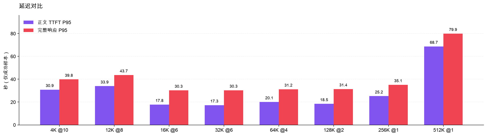

# Kimi K3 · UCloud 国内 prod 性能实测
正式测量 76/76 成功 · 分组 china_deployed · direct 路由
2026-10-14 12:47:14–13:03:06 UTC / 20:47:14–21:03:06 北京时间

- 正式测量 76/76 成功（100.0%）；成功要求有正文，不只看 HTTP 状态。
- 4K @10 正文 TTFT P50 7.20s，P95 30.88s；正文速度 P50 46.5 tok/s。
- 本轮正文 TTFT 中位数最高的档位为 512K @1：62.29s。各档并发不同，不是控制并发不变的纯上下文对比。
- 缓存为共享前缀预热后的混合状态；长上下文档位样本很少，结果不能外推为冷缓存性能、持续吞吐或 SLA。

| 测试项 / 并发 | 成功 / 请求 | 网关 P50 | 成功率 | TTFT P50 | TTFT P95 | TPOT P95 | tok/s P50 | 延迟 P99/P50 | 缓存 Token / 请求 | 观察 |
|---|---|---|---|---|---|---|---|---|---|---|
| 4K @10 | 20 / 20 | 72ms | 100.0% | 7.20s | 30.88s | 22.6ms | 46.5 | 2.29× | 93.8% / 100.0% | 样本全成功 |
| 12K @8 | 16 / 16 | 45ms | 100.0% | 8.75s | 33.94s | 21.6ms | 49.4 | 2.63× | 97.9% / 100.0% | 样本全成功 |
| 16K @6 | 12 / 12 | 41ms | 100.0% | 8.48s | 17.78s | 22.0ms | 47.7 | 1.77× | 98.4% / 100.0% | 样本全成功 |
| 32K @6 | 12 / 12 | 24ms | 100.0% | 11.86s | 17.30s | 22.4ms | 46.2 | 1.32× | 99.2% / 100.0% | 样本全成功 |
| 64K @4 | 8 / 8 | 30ms | 100.0% | 12.64s | 20.07s | 22.5ms | 47.3 | 1.24× | 99.6% / 100.0% | 样本全成功 |
| 128K @2 | 4 / 4 | 44ms | 100.0% | 17.45s | 18.45s | 21.8ms | 47.3 | 1.09× | 99.8% / 100.0% | 样本全成功 |
| 256K @1 | 2 / 2 | 68ms | 100.0% | 22.72s | 25.19s | 20.7ms | 53.9 | 1.08× | 99.9% / 100.0% | 样本全成功 |
| 512K @1 | 2 / 2 | 110ms | 100.0% | 62.29s | 68.70s | 22.0ms | 49.3 | 1.08× | 100.0% / 100.0% | 样本全成功 |

## 计量与归因

| 目标 / 并发 | 实际输入 tokens | 正文 tokens | 首个输出 P50 | 完整响应 P95 | 成功归因账号 | 失败 HTTP | 结束原因 | 缓存覆盖 |
|---|---|---|---|---|---|---|---|---|
| 4K @10 | 4096–4096 | 475–594 | 3.89s | 39.83s | {"4": 9, "3": 11} | {} | {"stop": 20} | 20/20 |
| 12K @8 | 12288–12288 | 475–594 | 5.16s | 43.66s | {"3": 13, "4": 3} | {} | {"stop": 16} | 16/16 |
| 16K @6 | 16384–16384 | 594–594 | 5.50s | 30.25s | {"4": 10, "3": 2} | {} | {"stop": 12} | 12/12 |
| 32K @6 | 32768–32768 | 475–594 | 8.18s | 30.31s | {"4": 6, "3": 6} | {} | {"stop": 12} | 12/12 |
| 64K @4 | 65538–65538 | 594–594 | 10.00s | 31.19s | {"3": 4, "4": 4} | {} | {"stop": 8} | 8/8 |
| 128K @2 | 131074–131074 | 475–594 | 13.64s | 31.39s | {"3": 2, "4": 2} | {} | {"stop": 4} | 4/4 |
| 256K @1 | 262150–262150 | 475–594 | 15.98s | 35.09s | {"3": 2} | {} | {"stop": 2} | 2/2 |
| 512K @1 | 524301–524301 | 594–594 | 60.25s | 79.91s | {"4": 1, "3": 1} | {} | {"stop": 2} | 2/2 |

## 失败与未测档位

512K 档已完成预算校准后的补测，原 budget_guard 跳过记录已补齐。
{"skipped_target": 524288, "reason": "budget_guard", "spent_usd": 0.7960640599, "reserved_usd": 5.2918272}

## 方法与边界

1. 发起端：UCloud 北京二 2 核 4 GiB / 5 Mbps prod 主机 → https://api-cn.tokenkey.dev/v1/chat/completions → china_deployed 真实账号池。key 的 routing_mode=direct；包含 Caddy、TokenKey 网关与供应商路径。不是绕过网关调用供应商原始 key，也不代表中国终端用户的网络体验。
2. 生产环境并非隔离压测环境；同一时段可能有用户流量与其他模型测试，未扣除共享资源干扰。结果代表本次窗口的 china_deployed 路径。
3. 每档 1 次预热，再跑 2 波闭环并发（10/8/6/6/4/2/1/1）；每波结束后启动下一波，无客户端重试，每请求独立 HTTP 连接，包含建连/TLS。预热与校准均不计主表；不是持续到达率或最大容量测试。网关内部重试可能影响耗时。
4. 固定随机种子英文工程词汇语料；前缀在各请求和档位之间复用，尾部请求编号不同。校准 3000 个词的供应商 token 用量，再调节词数接近各目标；K=1024，实际输入 token 以响应 usage 为准。缓存自然混合，预热请求不保证已在所有供应账号命中。
5. 流式 Chat Completions；max_tokens=2048，stream_options.include_usage=true，未指定 temperature 或 thinking，保留模型/网关默认行为。任务为忽略参考语料、逐行复述固定英文句子 20 次；这是合成性能测试，不评估问答质量或长上下文检索能力。
6. 成功须 HTTP 200、非空正文、finish_reason 为 stop/length 且收到 [DONE]；正常 length 截断也计成功，不代表完整遵循了任务。HTTP 200 但思考耗尽输出额度而无正文计失败。
7. 正文 TTFT=请求发起至首个非空正文 delta；首个输出包含 reasoning。TPOT=(末正文时间−首正文时间)/(completion_tokens−reasoning_tokens−1)，tok/s 为其倒数；TPOT P95 是每请求平均生成耗时的分位数，不是逐 token 间隔分位数。若出现 reasoning 但未返回 reasoning token 数，不报告正文 TPOT。
8. 网关 P50 来自按响应 X-Request-ID 关联的 usage_logs.gateway_latency_ms（接受数据库 local: 前缀），表示鉴权与路由阶段耗时并扣除队列等待；不包含上游等待、流传输与响应尾处理。未实测独立连通基线，不填推算值。
9. 延迟、TPOT、速度均只统计成功测量样本；成功率分母包含所有正式测量请求。失败耗时与原因保存在原始数据。分位数采用线性插值，少于 2 个成功样本不报告高分位；各档样本较少，P95/P99 仅描述本轮，不是稳定尾延迟或 SLA 证明。
10. 缓存 Token 命中率=Σcached_tokens/Σprompt_tokens；请求命中率=缓存 token>0 的成功请求数/提供缓存字段的成功请求数。缺字段显示 —，不当成 0；网关归因与缓存字段覆盖另表列出。
11. 没有提供客户准入阈值，“观察”只描述本轮样本是否全成功，不作达标判定。未知/未测/预算跳过档位保留为空，不能由失败推断模型上下文硬上限。
12. 测试设置 4.5 美元管理员独立 key 记账额度及逐档保守费用检查，正式测量累计运行超过 20 分钟不再启动新档；单次连接/读取超时 150 秒，收到事件时另检查 180 秒墙钟，因此阻塞读取可能使实际耗时超过 180 秒。测试完成后停用独立 key。实际成本按本测试用户的倍率记账，不是公开报价，也不代表供应商套餐现金结算。
13. 512K 最初被未计折扣的预算预留跳过；核对所有已入账请求的实际倍率为 0.3 后，在原 4.5 美元额度内补测，仍为 1 次预热 + 2 次正式请求，参数与测量方法不变。原始跳过及补测事件均保留。

预热 8 次；正式轮总成功 84/84；正式轮 usage 归因 84 条。正式轮标准成本 $3.838772，实际记账 $1.151632；含校准实际记账 $1.157457。独立 key #3 状态 inactive，停用后鉴权实测 HTTP 401；凭据未导出。

1=ali-token-plan-6；2=ali-token-plan-7；3=volcengine-agent-plan-3；4=volcengine-agent-plan-41

运行镜像：tokenkey-domestic/tokenkey:af85a7c219ae

[完整网页](report.html) · [总览 PNG](overview.png) · [原始指标](raw.json) · [汇总 JSON](summary.json)
